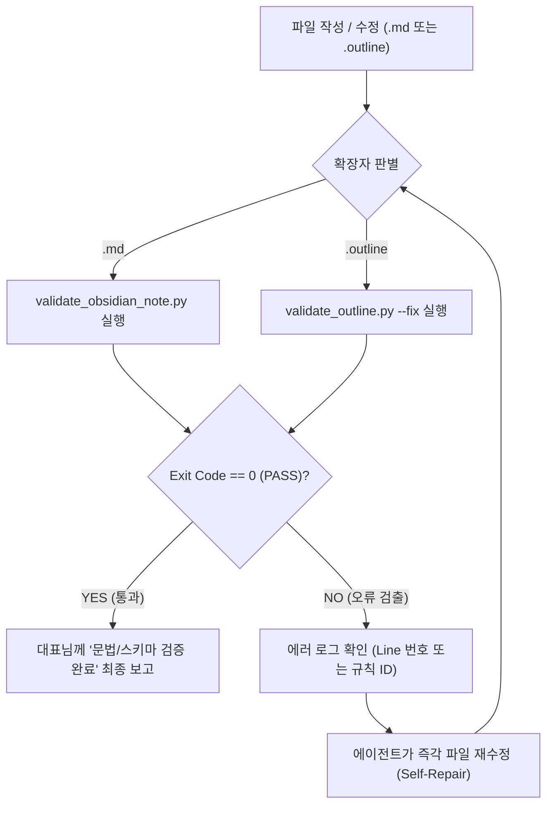

# 🛡️ External PM Obsidian Syntax & Outline Validator (`What-s-in-my-head` 전용)

이 스킬은 외부 프로젝트 관리 볼트(`What-s-in-my-head`) 내에 마크다운(`.md`) 카드나 아웃라인(`.outline`) 파일을 생성하거나 수정한 후, **옵시디언 데스크톱(Electron) 앱에서 파싱 크래시(빨간 에러 박스, 아웃라인 규격 오류)가 일체 발생하지 않도록 기본 문법과 Zod 런타임 스키마 결함을 기계적으로 신속 검증**하는 초경량 린터 워크플로우입니다.

---

## 🎯 1. 발동 시점 (Triggers)

다음 상황에서 코딩 에이전트는 완료 보고를 하기 전에 본 스킬을 반드시 실행합니다:
1. `What-s-in-my-head` 볼트 내 **마크다운(`.md`) 또는 아웃라인(`.outline`)** 파일을 신규 생성하거나 수정한 직후
2. 사용자가 "옵시디언 문법 체크해줘", "프론트매터 깨진 거 확인해", "아웃라인 규격 검증해"라고 지시할 때

---

## 🛠️ 2. 확장자별 검증 도구 분기 (Validator Dispatch)

에이전트는 수정/생성한 파일의 확장자에 따라 전용 검증기를 분기 실행합니다:

| 대상 파일 확장자 | 전용 검증 도구 경로 | 주요 검증 목적 |
| :--- | :--- | :--- |
| **마크다운 (`*.md`)** | `.agents/tools/obsidian/validator/validate_obsidian_note.py` | 속성 13종, YAML 문법, 단일 분류, 줄끝 LF, 거버넌스 칩 |
| **아웃라인 (`*.outline`)** | `.agents/tools/obsidian/outline_validator/validate_outline.py` | Zod 스키마(`version: "1.0.0"`, `id`), 노드 ID 고유성, 순환참조 방지 |

---

## 🔍 3. 핵심 린팅 항목 (The Core Linter Checks)

### [A] 마크다운(`.md`) 핵심 검증 항목 (`validator`)
| 린팅 항목 | 실패 조건 (Fail Criteria) | 교정 행동 (Self-Healing Action) |
| :--- | :--- | :--- |
| **1. 비따옴표 콜론 공백** | 값 내부에 큰따옴표 없이 `: `(콜론 뒤 공백)이 포함되어 키 매핑 오류를 유발할 때 | `요약:` 등 문자열 전체를 큰따옴표(`"..."`)로 감싸고 내부 콜론을 대시(`—`)로 치환 |
| **2. 줄끝 LF 검사 (CRLF 오염)** | 윈도우 환경에서 `\r\n`(CRLF)이 검출될 때 (속성창 경계선 인식 오류) | 줄바꿈을 `\n`(LF)으로 정규화하여 `newline=""` 옵션으로 재저장 |
| **3. YAML 기본 구문 검증** | `yaml.safe_load` 시 SyntaxError(들여쓰기, 괄호 등) 발생 시 | 들여쓰기 2칸 정렬 및 따옴표 닫힘 교정 |
| **4. 리스트 위키링크 안전성** | `- [[이름]]` 형태로 따옴표 없이 작성되어 중첩 리스트로 오인될 때 | 반드시 `- "[[이름]]"` 형태로 큰따옴표 감싸기 |
| **5. multitext 속성 타입 검증** | `분류`, `주제` 등 문자열 리스트에 따옴표 없는 마침표 숫자(`- 09.30`)가 들어가 float 캐스팅될 때 | 반드시 큰따옴표로 감싸 문자열(`- "09.30"`)로 작성 |
| **6. 단일 분류 검증 (Single Class Policy)** | `1.project` 구역에서 최상위 1레벨 프로젝트 폴더명 외에 하위 폴더명이 다중 침범했을 때 | 최상위 1레벨 프로젝트 관리 폴더명 단 하나만 남기고 하위 폴더명 일체 제거 |
| **7. 결정 카드 상태 무결성 (`DEC-STAT-001`)** | `discussions/*/decisions/` 경로의 결정 카드가 `상태: 결정 사항`이 아닐 때 | 상태를 `결정 사항`으로 통일 |
| **8. 원 정리본 데이터 혈통 (`DEC-LNK-001`)** | `Decision N` 카드의 프론트매터 `링크:`에 원본 회의록 위키링크가 누락되었을 때 | 원천 회의록/공유회 아웃풋의 `[[D{N}_...]]` 위키링크를 필수 바인딩 |
| **9. 버그 칩 무결성 (`SYS-BUG-001`)** | `🐛 버그 리포트` 카드의 `작성자` 속성에 `[[bug]]` 칩이 누락되었을 때 | 칸반 보드 식별을 위해 `작성자` 목록에 `[[bug]]`를 반드시 유지·추가 |
| **10. 상태값의 분류 속성 침범 방지** | `검토 중`, `진행 중`, `완료` 등 `상태` 속성 고유값이 `분류` 리스트에 오염되었을 때 | `분류` 속성에서 해당 상태값을 즉시 제거하여 관심사 분리 |
| **11. 리소스 구역 1레벨 단일 분류** | `3.resource` 구역 노트의 `분류`에 최상위 1레벨 폴더명 외에 서브폴더가 침범했을 때 | 최상위 1레벨 폴더명 단 하나만 남기고 일체 제거 |

### [B] 아웃라인(`.outline`) 핵심 검증 항목 (`outline_validator`)
| 린팅 항목 | 실패 조건 (Fail Criteria) | 교정 행동 (Self-Healing Action) |
| :--- | :--- | :--- |
| **12. 스키마 버전 문자열 (`OUT-SPEC-001`)** | `version`이 누락되었거나 문자열 `"1.0.0"`이 아닌 경우 (숫자 `1` 등) | `version: "1.0.0"`으로 엄격 보정 (`--fix` 지원) |
| **13. 최상위 프로젝트 ID (`OUT-SPEC-002`)** | 최상위 `id` 필드가 누락되었거나 빈 문자열인 경우 | 고유 난수 ID(`12자`) 자동 발급 및 삽입 |
| **14. 노드 ID 중복 및 순환참조 (`OUT-NODE-002/004`)** | 트리 내 노드 ID가 중복되거나 부모-자식 순환 참조가 발생한 경우 | 중복 노드에 새 고유 ID를 부여하고 순환 참조 링크 단선 |
| **15. 기본 뷰 모드 (`OUT-SPEC-005`)** | `defaultView` 값이 `'bullets'` 또는 `'board'`가 아닌 경우 | `defaultView: "bullets"`로 보정 |
| **16. 필수 타임스탬프 누락 (`OUT-SPEC-006`)** | 최상위 `createdAt` 또는 `updatedAt` 필드가 누락되었거나 숫자가 아닌 경우 | 현재 밀리초 타임스탬프(`number`)로 자동 보정 (`--fix` 지원) |
| **17. 인라인 이미지 첨부 분리 (`OUT-NODE-007`)** | 노드 `text`에 `![[...]]` 인라인 이미지가 포함되어 '딸린 파일 표시' 크기 제어가 무력화될 때 | `file: { target: ... }` 속성으로 자동 분리 및 `text` 정규화 (`--fix` 지원) |

---

## 💻 4. 표준 실행 프로토콜 (Agent Execution Guide)

에이전트는 파일을 작성하거나 수정한 후, `run_command` 도구를 사용하여 즉시 검증을 실행합니다.

### ① 마크다운(`.md`) 검증
```bash
# 단일 파일 검증
python .agents/tools/obsidian/validator/validate_obsidian_note.py "c:\경로\노트.md"

# 디렉토리 일괄 검증
python .agents/tools/obsidian/validator/validate_obsidian_note.py --dir "c:\경로\폴더"
```

### ② 아웃라인(`.outline`) 검증
```bash
# 단일 아웃라인 파일 검증 (결함 발견 시 자동 수복: --fix)
python .agents/tools/obsidian/outline_validator/validate_outline.py "c:\경로\파일.outline" --fix

# 디렉토리 일괄 검증
python .agents/tools/obsidian/outline_validator/validate_outline.py --dir "c:\경로\폴더"
```

---

## 🔄 5. 자가 수복 루프 (Self-Healing Loop)



1. 스크립트 실행 후 종료 코드가 `1`이면(에러 검출):
   * 콘솔에 출력된 `[FAIL] 파일명 -> 에러 원인` 로그를 확인합니다.
   * 대표님께 질문하거나 보고하기 전에, **에이전트 스스로 해당 결함을 즉각 수정**합니다.
2. 스크립트 재실행 후 `[PASS]` 및 `결과: 전수 통과!`가 출력될 때에만 사용자에게 완료 보고를 합니다.
