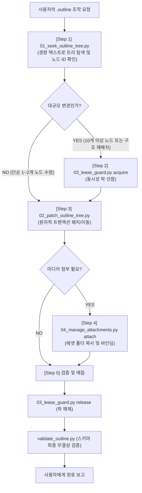

# 🌲 External PM Obsidian Outliner Collaborator (아웃라인 트리 조작 전문 스킬)

이 스킬은 사용자가 Obsidian Gaeddong Outliner 파일(`*.outline`)을 공유하며 **내용 조회, 노드 추가/수정/삭제, 계층 깊이(Depth) 이동 및 트리 재배치**를 요청할 때, **Workflowy 내장 MCP 아키텍처를 벤치마킹한 전용 CLI 도구 묶음을 통해 원시 JSON 파괴 없이 100% 안전하게 작업을 완수하는 전문 스킬**입니다.

---

## 🎯 1. 발동 시점 (Triggers)

다음 상황에서 코딩 에이전트는 본 스킬을 우선 발동합니다:
1. 사용자가 `*.outline` 파일을 `@`로 멘션하며 분석, 구조 변경, 내용 요약을 지시할 때
2. "이 아웃라인 내용 좀 고쳐줘", "불릿 추가해줘", "트리를 한 depth 아래로 밀어넣어줘"라고 요청할 때
3. 아웃라인 파일에 이미지나 다이어그램을 첨부하거나 노드 간 순서를 재배치하라고 할 때
4. 수천 줄 규모의 거대 `.outline` 파일에서 특정 키워드를 검색하거나 부모 족보 계층을 파악해야 할 때

---

## 🛠️ 2. 보유 도구 자산 (`.agents/tools/obsidian/outliner`)

에이전트는 원시 `.outline` JSON 파일을 `view_file`이나 `replace_file_content`로 직접 째고 꿰매지 않고, 아래의 전용 도구를 `run_command`로 실행합니다:

| 도구 스크립트 | 역할 및 특성 | 해결되는 결함 | 토큰 효율 |
| :--- | :--- | :--- | :--- |
| **`01_seek_outline_tree.py`** | JSON 노이즈 제거, 들여쓰기 텍스트 덤프, 상향(up)/하향(down) 탐색, 쿼리 필터 | 페이징 시 괄호 절단, grep 먹통, 부모 맥락 증발 방지 | **토큰 90% 이상 절감** |
| **`02_patch_outline_tree.py`** | 원자적 트랜잭션 기반 노드 수정, 삽입, 서브트리 이동(move/under), 재귀 삭제 | 마지막 쉼표 에러, ID 채번 누락, 인덱스 시프트, 자식 증발 방어 | **실패 시 100% 롤백** |
| **`03_lease_guard.py`** | 동시성 락 획득(`acquire`), 연장(`touch`), 반환(`release`), 사전 점검(`inspect`) | 사용자 실시간 타이핑과 충돌하는 덮어쓰기 유실(Race Condition) 차단 | **동시성 무결성 확보** |
| **`04_manage_attachments.py`** | 이미지/파일을 볼트 에셋 저장소에 자동 복사하고 노드에 바인딩(`attach`), 추출(`pull`) | 수동 파일 경로 계산 제거, Vision LLM 분석용 시각 자산 로컬 캐싱 | **멀티모달 파이프라인** |

---

## 📋 3. 5단계 아웃라인 조작 프로토콜 (The 5-Tier Protocol)

에이전트는 아웃라인 작업 시 다음 순서를 철저히 준수합니다:



### [Step 1] 탐색 및 지형도 파악 (Seek)
```bash
# 전체 트리를 1단계 깊이까지만 초경량으로 조망하여 노드 ID 확인
python .agents/tools/obsidian/outliner/01_seek_outline_tree.py "<아웃라인파일경로>" --depth 1

# 특정 키워드가 포함된 노드와 그 상위 족보(upward) 역추적
python .agents/tools/obsidian/outliner/01_seek_outline_tree.py "<아웃라인파일경로>" --query "검색어"
python .agents/tools/obsidian/outliner/01_seek_outline_tree.py "<아웃라인파일경로>" --node-id "<노드ID>" --direction up
```

### [Step 2] 동시성 락 선점 (Lease Acquire - 대규모 변경 시)
```bash
# 60초간 해당 파일 락 획득 (반환된 토큰 UUID 보관)
python .agents/tools/obsidian/outliner/03_lease_guard.py "<아웃라인파일경로>" acquire --ttl 60
```

### [Step 3] 원자적 패치 & 서브트리 재배치 (Patch)
```bash
# 1. 텍스트 수정
python .agents/tools/obsidian/outliner/02_patch_outline_tree.py "<아웃라인파일경로>" --replace "<노드ID>:수정할 새 문장"

# 2. 특정 노드의 자식(inside)으로 새 불릿 삽입
python .agents/tools/obsidian/outliner/02_patch_outline_tree.py "<아웃라인파일경로>" --insert "<부모노드ID>:새로운 자식 항" --position inside

# 3. ⭐️ 서브트리 한 depth 이동 / 부모 변경 (move & under)
python .agents/tools/obsidian/outliner/02_patch_outline_tree.py "<아웃라인파일경로>" --move "<이동할노드ID>:<새부모노드ID>"

# 4. 노드 및 자손 재귀 삭제
python .agents/tools/obsidian/outliner/02_patch_outline_tree.py "<아웃라인파일경로>" --delete "<삭제할노드ID>"
```

### [Step 4] 미디어 에셋 바인딩 (Attachments - 필요 시)
```bash
# 생성한 이미지/차트를 노드에 첨부
python .agents/tools/obsidian/outliner/04_manage_attachments.py "<아웃라인파일경로>" attach --node-id "<노드ID>" --file "<로컬이미지경로>"
```

### [Step 5] 락 반환 및 최종 스키마 린팅 (Release & Validate)
```bash
# 1. 락 해제
python .agents/tools/obsidian/outliner/03_lease_guard.py "<아웃라인파일경로>" release --token "<토큰UUID>"

# 2. 아웃라인 Zod 스키마 무결성 검증 (필수 게이트)
python .agents/tools/obsidian/outline_validator/validate_outline.py "<아웃라인파일경로>"
```

---

## 🧠 4. 아웃라인 작업 가이드라인 (Guardrails)

1. **원시 JSON 텍스트 직접 치환 절대 금지 (No Raw String Patching)** :
   - `.outline` 파일에 대해 `replace_file_content`나 정규식 치환을 직접 실행해서는 안 됩니다. 쉼표(`,`) 하나로 전체 파서가 크래시납니다. 반드시 `02_patch_outline_tree.py`를 거치십시오.
2. **1+1 메타 마크다운 카드 동기화 확인** :
   - 아웃라인의 제목이나 핵심 내용이 변경된 경우, 볼트 보드에서 카드가 실시간 반영될 수 있도록 인접한 동명의 `*.md` 카드의 속성(`요약`, `상태`)도 함께 점검하십시오.
3. **토큰 낭비 방지 (Token Blast Prevention)** :
   - 아웃라인의 내용을 파악할 때 `view_file`로 수천 줄의 JSON을 통째로 읽지 마십시오. 반드시 `01_seek_outline_tree.py --depth 1`로 먼저 전체 지형도를 확인하십시오.
4. **도메인 정체성 엄격 준수** :
   - 본 프로젝트는 **범용 문서 빌더/스캐폴딩 엔진, 리치 텍스트·캔버스 시각화, 도메인 중립 Agent 런타임 시스템**입니다. 소설, 웹소설 등 창작 용어나 비유는 일체 사용하지 않습니다.
5. **사전 중복 검색 및 계층화 (Pre-mutation Seek & Hierarchical Deduplication)** :
   - 노드를 신규 추가(`insert`)하거나 이동하기 전에 반드시 `01_seek_outline_tree.py --query "<키워드 또는 도메인>"`을 통해 트리에 동일하거나 유사한 엔티티가 이미 존재하는지 먼저 조회해야 합니다.
   - 동일 플랫폼이나 공통 상위 범주에 속하는 파생 항목(예: 동일 도메인의 서로 다른 서식·포맷)은 트리의 최상위에 평면적으로 분산 나열하지 말고, **상위 공통 불릿 아래의 자식 노드(서브트리, `inside` 또는 `move`)로 몰아넣어 계층화**해야 합니다.
