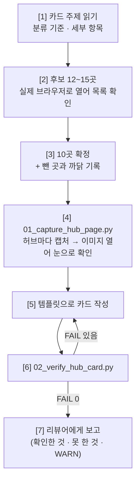

# 🗂️ External PM Source Hub Card Generator (`What-s-in-my-head` 전용)

이 스킬은 외부 볼트의 서식 수급처 카드(`1.collection/` 의 `NN. (기준) 항목 서식 수급처 Top 10.md`, 34장)를
**"다른 사람이 다시 열어 봐도 똑같이 보이는 것만 적은 카드"** 로 쓰는 작업자 워크플로우입니다.

카드는 리뷰어 스킬 `external_pm_06_source_hub_card_reviewer` 의 검사를 통과해야 끝납니다. **스스로 "완료"를 선언하지 않습니다.**

* **정답 예시**: [`examples/example_card_free_hubs.md`](./examples/example_card_free_hubs.md) — 볼트의 `01. (과금) 무료 서식 수급처 Top 10.md` 사본 (2026-10-25, 리뷰 통과)
* **자주 틀리는 것**: [`references/lessons_learned.md`](./references/lessons_learned.md) — **작업 전에 반드시 읽습니다.** 리뷰에서 두 번 이상 나온 지적이 여기 쌓입니다.

---

## 🎯 1. 발동 시점 (Triggers)

* "서식 수급처 NN번 카드 다시 써줘", "1.collection 카드 작업해"
* 리뷰어가 보낸 작업 지시서(`external_pm_06` 의 `templates/brief_template.md`)를 받았을 때
* 카드의 `## 💬 코멘트` 에 열린 리뷰 스레드(`> [!comment]+`)가 있어 반영하라고 할 때 → **§6 리뷰 반영**으로 바로 갑니다

---

## 📂 2. 대상 경로

| 무엇 | 경로 |
| :--- | :--- |
| 카드 | `c:\망고독 관련 자료\프로젝트_매니지먼트\What-s-in-my-head\3.📦(Resource) 자료\📑 문서_서식_수집_파이프라인\1.collection\NN. (…) … Top 10.md` |
| 캡처 | 같은 폴더의 `이미지\` — 파일 이름 `<카드 주제> 허브 NN - <허브 이름>.png` (볼트에 같은 이름 파일이 많아 짧은 이름 금지) |
| 출처 기록 | `이미지\capture_manifest.json` — **01 도구가 씁니다. 손으로 쓰지 않습니다** |
| 도구 | `.agents/tools/obsidian/source_hub/` (`01_capture_hub_page.py` · `02_verify_hub_card.py`) |

---

## 🚫 3. 절대 규칙 (위반 시 산출물 폐기)

1. **허브만 고릅니다.** 서식 한 장의 상세 페이지가 아니라 **서식 목록이 펼쳐지는 페이지**입니다. 판단 기준: 분류 탭 · 검색창 · 여러 서식의 목록이 화면에 보이는가.
2. **링크는 눈으로 연 페이지에서 따옵니다.** URL 모양을 보고 짐작해서 만들지 않습니다 (예: `counselSub.do?menuCode=41` → 404). 메뉴의 실제 `<a href>` 를 읽어 씁니다.
3. **이미지는 `01_capture_hub_page.py` 로만 만듭니다.** PIL · HTML 렌더링 · 목업으로 "화면처럼 보이는 그림"을 만드는 것은 **위조**입니다. 크롭은 위아래 여백 · 광고 · 쿠키 배너를 자르는 데만 씁니다. 그림 위에 글자 · 박스를 덧그리지 않습니다.
4. **숫자 · 이용 조건은 그 페이지에 적힌 것만 씁니다.** 건수는 화면의 "총 N건"을, 라이선스는 페이지 문구를 옮깁니다. 못 찾았으면 `확인 못 함` 이라고 씁니다. 일반 상식으로 채우지 않습니다.
5. **못 했으면 못 했다고 씁니다.** 브라우저 · 도구가 막히면 우회해서 그럴듯하게 채우지 말고 그 칸을 비우고 보고합니다. `전수 검증 완료` · `100%` · `완벽` · `검증된 공식 양식` 같은 **자기 인증 문구 금지** — 대신 "무엇을 어떻게 확인했는지"를 적습니다.
6. **봇 차단(Cloudflare 등)을 우회하지 않습니다.** 헤드리스가 막히면 사람이 보는 브라우저 화면을 저장해 `register` 하거나(까닭 필수), 못 찍었다고 보고합니다.
7. **뺀 후보도 남깁니다.** 카드 맨 아래 `## 넣지 않은 곳 — 왜 뺐나` 표. 없어진 갤러리 · 로그인 필요 · 서식이 몇 개 안 됨 · 유료 섞임 등.
8. **볼트 규칙을 지킵니다** (`What-s-in-my-head/CLAUDE.md`):
   * 속성 13종 전부. `분류` 는 **`📑 문서_서식_수집_파이프라인` 하나만** (`1.collection` 을 넣으면 린터 `CLS-RESOURCE-SINGLE-001` 위반).
   * `작성자` 는 본문을 쓴 **자기 이름** (`- "[[Antigravity]]"`). `커버` 는 비워 둡니다 (플러그인이 본문 첫 이미지로 채움).
   * `요약` 은 사실만. 줄끝 LF (`newline=""`). 파일을 지우지 않습니다.

---

## 🗺️ 4. 카드 한 장의 구조

템플릿: [`templates/hub_card_template.md`](./templates/hub_card_template.md)

```text
프론트매터 (속성 13종, 링크 = 허브 10개)
# 제목
> 분류 기준 · 상위 정의 · 고른 기준
%% 확인 방법 — 언제, 무엇으로 열었고, 무엇을 못 했는지 %%
| 요약 표: # · 허브 · 무엇이 있나(확인한 숫자) · 이용 조건(페이지 문구) · 포맷 |
## 허브마다: 허브 링크 · 무엇이 있나 · 이용 조건 · 파이프라인 관점 · ![[캡처]]
## 넣지 않은 곳 — 왜 뺐나
```

"파이프라인 관점" 만 **판단**입니다. 나머지 칸은 전부 **관찰**이고, 관찰 칸에 판단을 섞지 않습니다.

---

## 📋 5. 실행 7단계



### [Step 1] 카드 주제 읽기
기존 카드의 제목과 `> 분류 기준`/`세부 항목`(예: `(포맷) 스프레드시트 수식형`)을 읽고 **이 카드가 무엇을 모으는지** 한 줄로 정합니다. 다른 카드와 같은 허브가 겹쳐도 됩니다 — 카드마다 그 기준에서 왜 좋은지가 다릅니다.

### [Step 2] 후보 찾기 — 실제로 연다
* 후보마다 브라우저로 열어 **서식 목록이 보이는지**, 총 건수 · 분류 탭 · 이용 조건 문구가 어디 있는지 봅니다.
* 페이지 본문 텍스트(`read_url_content` · 브라우저 텍스트 읽기)로 숫자와 문구를 **그대로** 옮겨 적어 둡니다.
* 허브 안쪽 주소는 메뉴의 실제 링크를 읽어서 얻습니다.

### [Step 3] 10곳 확정
* 국내 · 해외를 섞습니다 (카드 주제가 한쪽이면 그 기준을 따름).
* 뺀 후보와 까닭을 메모합니다 → 카드 맨 아래 표.

### [Step 4] 캡처 — 01 도구로만
```bash
# 넉넉히(기본 1800px) 찍고, 이미지를 열어 본 뒤 --crop-top/--crop-bottom 으로 다시 찍는다
python .agents/tools/obsidian/source_hub/01_capture_hub_page.py capture --url "<허브 주소>" --out "<카드폴더>/이미지/<주제> 허브 NN - <이름>.png" --crop-top 0 --crop-bottom 1500
```
* **찍은 이미지를 반드시 열어 봅니다.** 봇 차단 화면 · 빈 화면 · 쿠키 배너가 목록을 가렸으면 다시 찍습니다. 도구가 `[WARN] 화면이 거의 한 색` 을 띄우면 거의 확실히 실패입니다.
* 헤드리스가 막힌 곳만: 사람이 보는 브라우저 화면을 저장 → `register --reason "<까닭>"`.
* 쿠키 배너는 **거부(Decline)** 를 누릅니다 (개인정보 쪽이 기본).

### [Step 5] 카드 작성
템플릿을 채웁니다. `링크` 속성 · 본문 `허브 링크` · 캡처의 주소가 **세 군데 모두 같은 주소**여야 합니다 (02 가 대조합니다).

### [Step 6] 기계 검사 — FAIL 0 까지
```bash
python .agents/tools/obsidian/source_hub/02_verify_hub_card.py "<카드.md>"
```
* `[FAIL]` 이 있으면 고치고 다시 돌립니다 (`50-develop/auto-fix-loop.md` 와 같은 방식).
* `[WARN]` 은 남아도 됩니다. 다만 **보고에 그대로 적습니다.**

### [Step 7] 보고
리뷰어(또는 사용자)에게 이 모양으로 보고합니다. 미사여구 없이:

```text
카드: <경로>
허브 10곳: <이름 나열>
02 결과: FAIL 0 · WARN N  (WARN 목록 그대로)
확인 못 한 것: <없으면 "없음">
뺀 후보: <이름 — 까닭>
```

---

## 🔁 6. 리뷰 반영 (리뷰어가 코멘트를 달았을 때)

1. 카드 맨 아래 `## 💬 코멘트` 에서 **열린 스레드**(`> [!comment]+ 💬 …`)를 모두 읽습니다. 지적마다 ID(`R-LINK-…` 등)가 붙어 있습니다.
2. 본문을 고칩니다. 이미지가 문제면 **다시 찍습니다** (01 도구).
3. 그 스레드 안, `^c-…` 줄 바로 위에 답글을 덧붙입니다. **스레드를 직접 닫지(✅) 않습니다** — 닫는 것은 리뷰어입니다.
   ```text
   >
   > **Antigravity** · 2026-10-26 10:12
   > 고침: <무엇을 어떻게>. 근거: <확인한 화면/문구>
   ```
   고치지 않았으면 그 까닭을 씁니다 ("이 페이지는 로그인이 필요해 확인 못 함" 등).
4. `02_verify_hub_card.py` 를 다시 돌리고 §5 Step 7 모양으로 보고합니다.

---

## 🧠 7. 가드레일 (Guardrails)

1. **증거 우선**: 쓴 문장마다 "어느 화면의 어느 글자에서 왔나" 를 댈 수 있어야 합니다. 못 대면 지웁니다.
2. **정답 예시를 베끼지 않습니다**: 예시는 모양을 보여 줄 뿐입니다. 다른 카드에 같은 허브를 쓰면 숫자 · 문구를 **다시 열어서** 적습니다.
3. **워크스페이스를 넓히지 않습니다**: 다른 카드나 리뷰 기록을 읽어 답을 맞추지 않습니다 (`50-develop/agy-cli/01_scripting_guide` E항).
4. **도메인 용어**: 이 볼트의 문서 서식 파이프라인 맥락으로만 씁니다. 웹소설 · 창작 비유를 섞지 않습니다.
