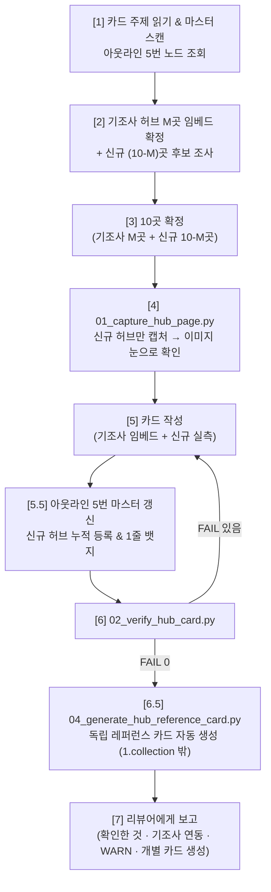

# 🗂️ External PM Source Hub Card Generator (`What-s-in-my-head` 전용)

이 스킬은 외부 볼트의 서식 수급처 카드(`1.collection/` 의 `NN. (기준) 항목 서식 수급처 Top 10.md`, 34장)를
**"다른 사람이 다시 열어 봐도 똑같이 보이는 것만 적은 카드"** 로 쓰는 작업자 워크플로우입니다.

카드는 리뷰어 스킬 `external_pm_06_source_hub_card_reviewer` 의 검사를 통과해야 끝납니다. **스스로 "완료"를 선언하지 않습니다.**

* **정답 예시**: [`examples/example_card_free_hubs.md`](./examples/example_card_free_hubs.md) — 볼트의 `01. (과금) 무료 서식 수급처 Top 10.md` 사본 (2026-10-25, 리뷰 통과)
* **자주 틀리는 것**: [`references/lessons_learned.md`](./references/lessons_learned.md) — **작업 전에 반드시 읽습니다.** 리뷰에서 두 번 이상 나온 지적이 여기 쌓입니다.

---

## 🎯 1. 발동 시점 (Triggers)

* "서식 수급처 NN번 카드 다시 써줘", "1.collection 카드 작업해"
* 리뷰어가 보낸 작업 지시서(`external_pm_06` 의 `templates/brief_template.md`)를 받았을 때
* 카드의 `## 💬 코멘트` 에 열린 리뷰 스레드(`> [!comment]+`)가 있어 반영하라고 할 때 → **§6 리뷰 반영**으로 바로 갑니다

---

## 📂 2. 대상 경로

| 무엇 | 경로 |
| :--- | :--- |
| 카드 | `c:\망고독 관련 자료\프로젝트_매니지먼트\What-s-in-my-head\3.📦(Resource) 자료\📑 문서_서식_수집_파이프라인\1.collection\NN. (…) … Top 10.md` |
| 마스터 레지스트리 (아웃라인) | `c:\망고독 관련 자료\프로젝트_매니지먼트\What-s-in-my-head\3.📦(Resource) 자료\📑 문서_서식_수집_파이프라인\디지털_문서_서식_플랫폼_정의_및_글로벌_벤치마크.outline` (5번 노드 `📌 5. 실제 조사 완료된 수급처 허브 목록`) |
| 캡처 | 같은 폴더의 `이미지\` — 파일 이름 `<카드 주제> 허브 NN - <허브 이름>.png` (볼트에 같은 이름 파일이 많아 짧은 이름 금지) |
| 출처 기록 | `이미지\capture_manifest.json` — **01 도구가 씁니다. 손으로 쓰지 않습니다** |
| 도구 | `.agents/tools/obsidian/source_hub/` (`01_capture_hub_page.py` · `02_verify_hub_card.py` · `03_append_hub_to_outline.py`) |

---

## 🚫 3. 절대 규칙 (위반 시 산출물 폐기)

1. **허브만 고릅니다.** 서식 한 장의 상세 페이지가 아니라 **서식 목록이 펼쳐지는 페이지**입니다. 판단 기준: 분류 탭 · 검색창 · 여러 서식의 목록이 화면에 보이는가.
2. **링크는 눈으로 연 페이지에서 따옵니다.** URL 모양을 보고 짐작해서 만들지 않습니다 (예: `counselSub.do?menuCode=41` → 404). 메뉴의 실제 `<a href>` 를 읽어 씁니다.
3. **이미지는 `01_capture_hub_page.py` 로만 만듭니다.** PIL · HTML 렌더링 · 목업으로 "화면처럼 보이는 그림"을 만드는 것은 **위조**입니다. 크롭은 위아래 여백 · 광고 · 쿠키 배너를 자르는 데만 씁니다. 그림 위에 글자 · 박스를 덧그리지 않습니다.
4. **숫자 · 이용 조건은 그 페이지에 적힌 것만 씁니다.** 건수는 화면의 "총 N건"을, 라이선스는 페이지 문구를 옮깁니다. 못 찾았으면 `확인 못 함` 이라고 씁니다. 일반 상식으로 채우지 않습니다.
5. **못 했으면 못 했다고 씁니다.** 브라우저 · 도구가 막히면 우회해서 그럴듯하게 채우지 말고 그 칸을 비우고 보고합니다. `전수 검증 완료` · `100%` · `완벽` · `검증된 공식 양식` 같은 **자기 인증 문구 금지** — 대신 "무엇을 어떻게 확인했는지"를 적습니다.
6. **봇 차단(Cloudflare 등)을 우회하지 않습니다.** 헤드리스가 막히면 사람이 보는 브라우저 화면을 저장해 `register` 하거나(까닭 필수), 못 찍었다고 보고합니다.
7. **뺀 후보도 남깁니다.** 카드 맨 아래 `## 넣지 않은 곳 — 왜 뺐나` 표. 없어진 갤러리 · 로그인 필요 · 서식이 몇 개 안 됨 · 유료 섞임 등.
8. **볼트 규칙을 지킵니다** (`What-s-in-my-head/CLAUDE.md`):
   * 속성 13종 전부. `분류` 는 **`📑 문서_서식_수집_파이프라인` 하나만** (`1.collection` 을 넣으면 린터 `CLS-RESOURCE-SINGLE-001` 위반).
   * `작성자` 는 본문을 쓴 **자기 이름** (`- "[[Antigravity]]"`). `커버` 는 비워 둡니다 (플러그인이 본문 첫 이미지로 채움).
   * `요약` 은 사실만. 줄끝 LF (`newline=""`). 파일을 지우지 않습니다.
9. **플랫폼 세대별 '진짜 허브' 뷰를 확보합니다 (`L-09`):**
   * **1~2세대 (파일/포털형)**: 상단에 거대 이벤트 배너(Hero)가 화면을 덮으면 `--crop-top` (예: 400~600)으로 배너를 잘라내고 서식 그리드가 화면 중심에 오게 합니다.
   * **2.5세대 (CaaS형)**: 겉핥기 소개 페이지(`intro/`)가 아닌, 실제 **문서 라이브러리/프로그램 선택/작성 위자드 뷰**를 잡습니다. CaaS는 파일 목록이 아닌 조항 조립 인터페이스가 본체입니다.
10. **기조사 자원 중복 조사 금지 및 도메인 단위 사전 대조 (`L-10`, `L-12` — `H-DUP-001`, `H-DUP-002`):**
    * **사전 도메인 스캔 필수**: 새 카드를 쓸 때 맨 먼저 상위 아웃라인 5번 노드(`📌 5. 실제 조사 완료된 수급처 허브 목록`)를 스캔하여 현재 기준에 부합하는 기조사 허브(M곳)를 파악합니다. 특히 후보를 발굴할 때 반드시 **도메인(호스트) 단위로 `01_seek_outline_tree.py --query "<도메인>"` 사전 검색**을 실행하여 해당 플랫폼이 이미 5번 노드에 등록되어 있는지 전수 확인합니다.
    * **원천 헤더 트랜스클루전 연동**: 이미 실측 검증된 수급처(동일 URL/동일 서식)는 절대로 브라우저로 재조사/재캡처하지 않고, **원천 카드의 섹션 헤더를 직접 임베드(`![[원천카드명#헤더명]]`)** 하여 데이터 무결성을 유지하고 리소스를 아낍니다.
    * **부족분만 신규 실측**: 10곳 중 부족한 슬롯(10 - 기조사 수)만 순수 신규 허브로 실측 브라우저 검증을 진행합니다.
    * **단일 플랫폼 서브카탈로그화 강제 (`L-12`)**: 동일 도메인(예: `create.microsoft.com`, `yesform.com`)의 서로 다른 포맷이나 하위 허브는 **마스터 아웃라인 5번 노드 최상위에 별도 플랫폼으로 분산 등록하는 것을 엄격히 금지**합니다. 반드시 상위 플랫폼 공통 노드 아래의 **자식 노드(서브카탈로그, `--parent`)**로 몰아넣어야 합니다. 종속 원천(국세청→법제처)은 상위 원천 노드의 파생 입구로 통합합니다.
11. **아웃라인 8대 분류 뱃지는 4번 노드 정규 어휘 외 사용 절대 금지 (`L-11` — `H-TAX-001`):**
    * 상위 아웃라인 5번 노드에 등록하는 뱃지는 반드시 **'4. 서식 템플릿 수급처 분류 기준 (Data Pipeline Source Types)'에 정의된 38개 정규 어휘**만 사용해야 합니다.
    * 임의 어휘(예: `부분 무료(Freemium)`, `공공누리형`, `상업 이용 자유형`, `프레젠테이션 슬라이드형`, `CaaS 솔루션` 등)를 창작하여 기재하면 수급처 검증기 `H-TAX-001` 위반으로 즉각 `[FAIL]` 처리됩니다.
    * 다중 선택 항목은 공백과 가운데점 ` · ` (예: `【경영·전략 · 인사·노무】`)으로 연결하며, 정확히 8대 기준 8개 뱃지(`H-TAX-002`)를 준수해야 합니다.
12. **신규 실측 허브의 '독립 레퍼런스 카드' 자동 생성 및 배치 (`L-13`):**
    * 카드 작성 및 아웃라인 5번 노드 등록 후, 최종 단계로 **독립 레퍼런스 카드(`(web)<허브명>.md`)를 `1.collection` 밖 상위 디렉터리(`3.📦(Resource) 자료\📑 문서_서식_수집_파이프라인\`)에 생성**해야 합니다.
    * **명명 규칙**: `(web)<허브명>.md`를 엄격히 준수합니다. `(web&강추)` 등 임의의 강조 구분자는 **사용자가 직접 평가하고 관리하는 고유 구분자이므로 에이전트가 임의로 붙이지 않습니다**.
    * **동일 플랫폼 다중 카탈로그 통합**: `Microsoft Create`, `예스폼`, `Jotform` 등 동일 플랫폼은 개별 카드를 분산 생성하지 않고 **'대표 카드 1장'**으로 통합하고, 세부 서식 카탈로그와 캡처 이미지는 H2.x 서브 섹션으로 온전히 수록합니다.
    * **실측 캡처 이미지 paste 필수**: 해당 허브의 캡처 이미지를 본문 최상단 및 프론트매터 `커버:`에 1:1로 반드시 임베드합니다.
    * **공식 CLI 도구 사용**: `python .agents/tools/obsidian/source_hub/04_generate_hub_reference_card.py --card "<카드.md>"`를 실행하여 자동 생성합니다.


---

## 🗺️ 4. 카드 한 장의 구조

템플릿: [`templates/hub_card_template.md`](./templates/hub_card_template.md)

```text
프론트매터 (속성 13종, 링크 = 전체 허브 10개 주소)
# 제목
> 분류 기준 · 상위 정의 · 고른 기준
%% 확인 방법 — 중복 방지 연동 현황, 신규 실측 방법, 언제/무엇으로 열었는지 %%
| 요약 표: # · 허브 · 무엇이 있나(확인한 숫자) · 이용 조건(페이지 문구) · 포맷 · 연동 상태 |

<!-- 기조사 자원이 있을 때: 2개 섹션으로 명확히 구분 -->
## 1. 기조사 자원 연동 (기존 카드 임베드 · M곳)
### N. {{기관·서비스}} — {{허브 이름}}
* **허브 링크**: {{주소}}
* **원천 카드**: [[원천 카드#N. 기관·서비스 — 허브 이름]]
![[원천 카드#N. 기관·서비스 — 허브 이름]]

## 2. 순수 신규 조사 대상 허브 (실측 조사 · 10-M곳)
### N. {{기관·서비스}} — {{허브 이름}}
* **허브 링크**: {{링크 속성과 똑같은 주소}}
* **무엇이 있나**: {{화면에 보이는 것 — 건수, 분류 탭, 검색, 버튼}}
* **이용 조건**: {{페이지 문구 인용 — "…"}}
* **파이프라인 관점**: {{판단 — 원문째 쓸 수 있나 / 레퍼런스로만인가 / 무엇을 뽑기 좋은가}}
![[캡처.png]]

## 넣지 않은 곳 — 왜 뺐나
```

* 기조사 자원은 원천 카드의 섹션 헤더를 직접 트랜스클루전(`![[카드#헤더]]`)하여 내용과 캡처를 그대로 재사용합니다.
* "파이프라인 관점" 만 **판단**입니다. 나머지 칸은 전부 **관찰**이고, 관찰 칸에 판단을 섞지 않습니다.

---

## 📋 5. 실행 7단계



### [Step 1] 카드 주제 읽기 & 마스터 레지스트리 사전 스캔 (`L-10`, `L-12`)
* 기존 카드의 제목과 `> 분류 기준`/`세부 항목`을 읽고 **이 카드가 무엇을 모으는지** 한 줄로 정합니다.
* **사전 스캔 ("두 번 일하지 마라")**: 상위 아웃라인 5번 노드(`📌 5. 실제 조사 완료된 수급처 허브 목록`)를 스캔하여 현재 기준에 부합하는 **기조사 허브(M곳)** 를 파악합니다.
* 기조사 허브는 원천 카드의 섹션 헤더 직접 임베드(`![[원천카드#헤더]]`)로 배치를 확정하고 재조사 목록에서 제외합니다.

### [Step 2] 후보 찾기 & 도메인 사전 중복 대조 (`L-12` — `H-DUP`)
* 10곳 중 기조사 자원을 제외한 **부족분(`10 - M`곳)** 만 후보를 추립니다.
* **도메인 단위 사전 중복 확인 (필수)**:
  후보를 정하기 전에 반드시 전용 탐색 도구로 해당 도메인이 아웃라인 5번 노드에 이미 존재하는지 조회합니다:
  ```bash
  python .agents/tools/obsidian/outliner/01_seek_outline_tree.py "<아웃라인파일>" --query "<후보도메인 또는 호스트>"
  ```
  - **이미 동일 서식이 등록된 경우**: 신규 조사 금지 → Step 1의 기조사 임베드로 즉시 전환.
  - **동일 플랫폼이지만 서로 다른 포맷인 경우** (예: Word vs Excel vs PPT): 최상위 신규 플랫폼으로 추가하지 않고, **상위 플랫폼 공통 노드 아래의 서브카탈로그로 묶을 계획(`--parent`)**을 세웁니다.
* **실측 조사**: 브라우저로 열어 **서식 목록이 보이는지**, 총 건수 · 분류 탭 · 이용 조건 문구가 어디 있는지 봅니다.
* 페이지 본문 텍스트(`read_url_content` · 브라우저 텍스트 읽기)로 숫자와 문구를 **그대로** 옮겨 적어 둡니다.
* CaaS 플랫폼은 마케팅 소개가 아닌 실제 라이브러리/프로그램 목록 URL을 확보합니다.

### [Step 3] 10곳 확정
* 기조사 허브 M곳 + 신규 허브 (10 - M)곳으로 10곳을 확정합니다.
* 국내 · 해외를 적절히 배분합니다.
* 뺀 후보와 까닭을 메모합니다 → 카드 맨 아래 표.

### [Step 4] 캡처 — 신규 허브만 01 도구로 실행
```bash
# 신규 허브만 캡처 진행 (기조사 허브는 원천 카드 캡처를 트랜스클루전으로 공유)
python .agents/tools/obsidian/source_hub/01_capture_hub_page.py capture --url "<허브 주소>" --out "<카드폴더>/이미지/<주제> 허브 NN - <이름>.png" --crop-top 0 --crop-bottom 1500
```
* **찍은 이미지를 반드시 열어 봅니다.** 봇 차단 화면 · 빈 화면 · 쿠키 배너가 목록을 가렸거나, 상단 마케팅 배너만 크게 찍혔으면 `--crop-top` 을 조절해 다시 찍습니다.
* 헤드리스가 막힌 곳만: 사람이 보는 브라우저 화면을 저장 → `register --reason "<까닭>"`.

### [Step 5] 카드 작성
* 템플릿을 채웁니다. 프론트매터 `링크` 에는 10곳의 URL을 모두 채웁니다.
* 기조사 허브는 `## 1. 기조사 자원 연동` 구역에 원천 섹션 헤더를 직접 트랜스클루전(`![[원천카드#헤더]]`)합니다.
* 신규 허브는 `## 2. 순수 신규 조사 대상 허브` 구역에 링크/무엇이 있나/이용 조건/파이프라인 관점/캡처를 작성합니다.

### [Step 5.5] 아웃라인 5번 마스터 레지스트리 현행화 (`L-10`, `L-11`, `L-12`)
* 신규 실측한 허브들을 상위 아웃라인(`디지털_문서_서식_플랫폼_정의_및_글로벌_벤치마크.outline`) 5번 노드에 등록합니다.
* **공식 CLI 도구 사용**: 수작업 등록 시 휴먼 에러를 방지하기 위해 `03_append_hub_to_outline.py` 를 실행합니다.
```bash
# 1. 독립 단일 플랫폼 신규 등록
python .agents/tools/obsidian/source_hub/03_append_hub_to_outline.py \
  --card "<카드 파일명>" \
  --header "<N. 허브 헤더명>" \
  --display "<표시명 (특징/구분)>" \
  --url "<실측 URL>" \
  --badge "【과금】 【도메인】 【출처】 【포맷】 【형태】 【시장】 【라이선스】 【수집】"

# 2. 동일 플랫폼 내 하위 서브카탈로그 등록 (동일 도메인이 이미 존재할 때 필수)
python .agents/tools/obsidian/source_hub/03_append_hub_to_outline.py \
  --card "<카드 파일명>" \
  --header "<N. 허브 헤더명>" \
  --display "<표시명 (특징/구분)>" \
  --url "<실측 URL>" \
  --badge "【과금】 【도메인】 【출처】 【포맷】 【형태】 【시장】" \
  --parent "<상위 플랫폼 노드명 (예: Microsoft Create (create.microsoft.com))>"
```

* ⛔ **도메인 중복 차단 (`H-DUP-001`, `H-DUP-002`)**:
  - 이미 5번 노드에 등록된 도메인인 경우 `--parent` 옵션 없이 최상위로 추가하려 하면 도구가 즉시 `[FAIL]`로 차단합니다.
  - 동일 도메인의 서로 다른 서비스는 반드시 `--parent`를 주어 상위 플랫폼 노드 하위로 묶으십시오.
* ⛔ **분류 뱃지 어휘 절대 규칙 (`H-TAX-001`, `H-TAX-002`)**:
  뱃지 안의 단어는 반드시 **4번 노드('서식 템플릿 수급처 분류 기준')의 28개 정규 어휘**만 사용해야 합니다 (라이선스/수집방식 2대 기준은 비활성화/제거됨).
  
  | 기준 | 선택 유형 | 4번 노드 공식 허용 정규 어휘 (28개 외 사용 금지) |
  | :--- | :--- | :--- |
  | **1. 과금 모델** | 다중 | `무료`, `유료` |
  | **2. 도메인** | 다중 | `경영·전략`, `법률·규약`, `재무·회계`, `인사·노무`, `영업·제안`, `제품·엔지니어링`, `마케팅·브랜딩`, `리서치·시장조사`, `운영·매뉴얼`, `디자인·크리에이티브` |
  | **3. 출처 유형** | 단일 | `공식 플랫폼`, `커뮤니티·포럼`, `개인 미디어·블로그`, `정부·공공 포털` |
  | **4. 파일 포맷** | 다중 | `문서 텍스트형`, `스프레드시트 수식형`, `슬라이드 시각형`, `클라우드 블록형`, `고정 인쇄형` |
  | **5. 서식 형태** | 다중 | `빈 뼈대 양식`, `가이드·해설 동반 양식`, `실전 완성 사례`, `자동화 연산 양식` |
  | **6. 적용 시장** | 단일 | `국내 표준형`, `글로벌 영미권형`, `크로스보더 다국어형` |

  * 다중 선택 항목은 공백과 가운데점 ` · ` (예: `【경영·전략 · 인사·노무】`)으로 연결합니다.
  * 뱃지는 정확히 6개입니다 (`H-TAX-002`). (7. 라이선스, 8. 수집방식은 비활성화됨)
* 등록 후 `python .agents/tools/obsidian/source_hub/02_verify_hub_card.py "<카드.md>"` 로 H-TAX 통과를 확인합니다.

### [Step 6] 기계 검사 — FAIL 0 까지
```bash
python .agents/tools/obsidian/source_hub/02_verify_hub_card.py "<카드.md>"
python .agents/tools/obsidian/validator/validate_obsidian_note.py "<카드.md>"
```
* `[FAIL]` 이 있으면 고치고 다시 돌립니다.
  - 특히 `H-DUP-001`(이미 등록된 동일 URL)이 발생하면 실측 섹션에서 제거하고 트랜스클루전 임베드로 변경합니다.
  - `H-DUP-002`(동일 플랫폼 도메인 존재) 경고가 발생하면 아웃라인에서 서브카탈로그화가 되었는지 확인합니다.
* `[WARN]` 은 남아도 되지만 보고에 명시합니다.

### [Step 6.5] 독립 레퍼런스 카드('(web)<허브명>.md') 자동 생성 (`L-13`)
Top 10 카드의 기계 검사가 통과되면, **최종 작업으로 해당 카드의 허브들을 단독 레퍼런스 카드로 자동 생성**합니다:
```bash
python .agents/tools/obsidian/source_hub/04_generate_hub_reference_card.py --card "<카드.md>"
```
* **생성 위치**: 반드시 `1.collection` 외부 상위 디렉터리(`3.📦(Resource) 자료/📑 문서_서식_수집_파이프라인/`)에 생성됩니다.
* **명명 규칙**: `(web)<허브명>.md`를 엄격 준수합니다. `(web&강추)` 등 임의의 강조 구분자는 **사용자가 직접 관리하는 고유 구분자이므로 에이전트가 절대 붙이지 않습니다**.
* **동일 플랫폼 다중 카탈로그 통합**: `Microsoft Create`, `예스폼`, `Jotform` 등 동일 플랫폼은 개별 카드를 분산 생성하지 않고 **'대표 카드 1장'**으로 통합되며, 세부 카탈로그와 캡처 이미지는 본문 H2.x 서브 섹션으로 온전히 수록됩니다.
* **실측 캡처 이미지 paste 확인**: 각 카드의 본문 최상단 및 프론트매터 `커버:`에 실측 캡처 이미지가 1:1로 반드시 임베드되었는지 확인합니다.
* **생성 카드 전수 린터 검증**:
  ```bash
  python .agents/tools/obsidian/validator/validate_obsidian_note.py "<생성된 (web)*.md 파일>"
  ```
  `[PASS]` 통과를 확인합니다.

### [Step 7] 보고
리뷰어(또는 사용자)에게 이 모양으로 보고합니다:

```text
카드: <경로>
허브 10곳: 기조사 연동 M곳 (`원천카드`), 신규 실측 N곳
02 결과: FAIL 0 · WARN N (WARN 목록 그대로)
마스터 레지스트리: 5번 아웃라인 노드 등록 완료 (validate PASS)
독립 레퍼런스 카드: 04 도구로 (web)<허브명>.md N장 생성 완료 (1.collection 밖 배치, 린터 PASS)
확인 못 한 것: <없으면 "없음">
뺀 후보: <이름 — 까닭>
```

---

## 🔁 6. 리뷰 반영 (리뷰어가 코멘트를 달았을 때)

1. 카드 맨 아래 `## 💬 코멘트` 에서 **열린 스레드**(`> [!comment]+ 💬 …`)를 모두 읽습니다. 지적마다 ID(`R-LINK-…` 등)가 붙어 있습니다.
2. 본문을 고칩니다. 이미지가 문제면 **다시 찍습니다** (01 도구).
3. 그 스레드 안, `^c-…` 줄 바로 위에 답글을 덧붙입니다. **스레드를 직접 닫지(✅) 않습니다** — 닫는 것은 리뷰어입니다.
   ```text
   >
   > **Antigravity** · 2026-10-26 10:12
   > 고침: <무엇을 어떻게>. 근거: <확인한 화면/문구>
   ```
   고치지 않았으면 그 까닭을 씁니다 ("이 페이지는 로그인이 필요해 확인 못 함" 등).
4. `02_verify_hub_card.py` 를 다시 돌리고 §5 Step 7 모양으로 보고합니다.

---

## 🧠 7. 가드레일 (Guardrails)

1. **증거 우선**: 쓴 문장마다 "어느 화면의 어느 글자에서 왔나" 를 댈 수 있어야 합니다. 못 대면 지웁니다.
2. **정답 예시를 베끼지 않습니다**: 예시는 모양을 보여 줄 뿐입니다. 다른 카드에 같은 허브를 쓰면 숫자 · 문구를 **다시 열어서** 적습니다.
3. **워크스페이스를 넓히지 않습니다**: 다른 카드나 리뷰 기록을 읽어 답을 맞추지 않습니다 (`50-develop/agy-cli/01_scripting_guide` E항).
4. **도메인 용어**: 이 볼트의 문서 서식 파이프라인 맥락으로만 씁니다. 웹소설 · 창작 비유를 섞지 않습니다.
