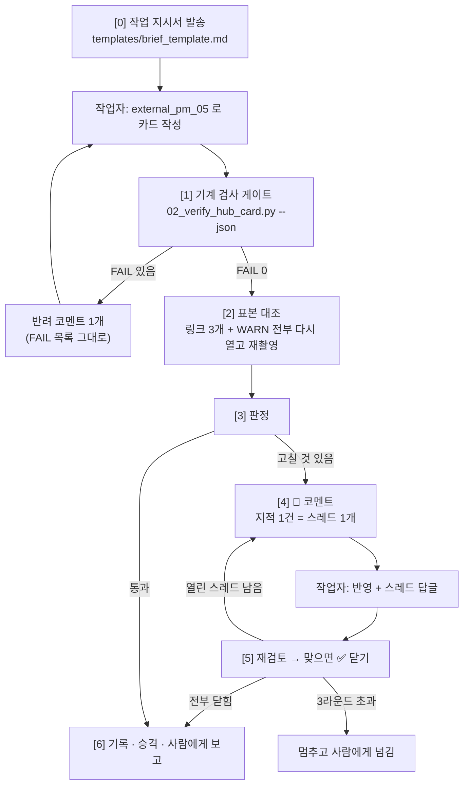

# 🔍 External PM Source Hub Card Reviewer (`What-s-in-my-head` 전용)

이 스킬은 작업 에이전트(Antigravity 등)가 `external_pm_05_source_hub_card_generator` 로 쓴 서식 수급처 카드를
**가르치고 → 시키고 → 검사하고 → 피드백하는** 리뷰어 워크플로우입니다.

핵심은 **작업자의 말을 믿지 않는 것**입니다. 작업자 보고는 참고만 하고, 판정은 ① 기계 검사 결과와 ② 리뷰어가 직접 다시 연 화면으로만 합니다.

* 작업자 스킬: [`../external_pm_05_source_hub_card_generator/SKILL.md`](../external_pm_05_source_hub_card_generator/SKILL.md)
* 도구: `.agents/tools/obsidian/source_hub/` ([README](../../tools/obsidian/source_hub/README.md))
* 라운드 기록: [`references/review_log.md`](./references/review_log.md)

---

## 🎯 1. 발동 시점 (Triggers)

* "NN번 카드 리뷰해줘", "서식 수급처 카드 검수해"
* "Antigravity 한테 NN번 시키고 봐줘", "피드백 루프 돌려"
* 작업자가 "리뷰 반영했습니다" 라고 보고했을 때 (→ Step 5 재검토)

---

## 🧭 2. 역할 분리 (지키지 않으면 루프가 무너집니다)

| | 작업자 (`external_pm_05`) | 리뷰어 (이 스킬) |
| :--- | :--- | :--- |
| 카드 본문 · 캡처 | **쓴다** | **고치지 않는다** — 고치면 작업자가 배우지 못하고, 같은 실수가 다음 카드에 또 나옵니다 |
| 💬 코멘트 | 답글을 단다 | 스레드를 연다 · 닫는다(✅) |
| 기계 검사 | 보고 전 자가 검사 | 게이트 — FAIL 이면 사람 리뷰 없이 반려 |
| 스킬 · 검사기 | 읽기만 | 반복 지적을 `lessons_learned.md` · `02` 규칙으로 승격 |

예외는 하나 — 작업자가 볼트 데이터를 망가뜨렸을 때(엑스칼리드로우 프론트매터 삭제 등)만 리뷰어가 되돌리고 사람에게 알립니다.

---

## 🔁 3. 루프 한 바퀴



---

## 📋 4. 단계별 프로토콜

### [Step 0] 작업 지시서 발송
[`templates/brief_template.md`](./templates/brief_template.md) 를 채워 작업자에게 보냅니다. 전하는 방법은 둘입니다.

**A. 수동 (기본)** — 채운 지시서를 사용자에게 주고, 사용자가 Antigravity 창에 붙여 넣습니다. 피드백은 카드 안 💬 코멘트로 남기므로 작업자가 직접 읽습니다.

**B. 자동 (`agy` CLI)** — 리뷰어가 터미널로 작업자를 부릅니다. `50-develop/agy-cli/01_scripting_guide/rule.md` 를 따릅니다.
```bash
# 지시서는 파일로 써서 stdin 으로 (명령줄 인자로 길게 넘기지 않음)
agy -p --output-format json --disable-slash-commands \
    --add-dir "c:\망고독 관련 자료\프로젝트_매니지먼트\What-s-in-my-head\3.📦(Resource) 자료\📑 문서_서식_수집_파이프라인\1.collection" \
    < "<임시폴더>/brief_NN_r1.md" > "<임시폴더>/agy_NN_r1.json"
# 다음 라운드는 같은 대화로: --conversation <앞 결과의 대화 ID>
```
* `--add-dir` 은 **카드 폴더 하나만** 엽니다 (다른 카드 · 리뷰 기록을 베끼지 못하게).
* 헤드리스에서는 권한 승인을 못 받아 도구 호출이 거부됩니다. 규칙은 `--dangerously-skip-permissions` 를 쓰라고 하지만,
  **이 플래그는 사용자가 그 세션에서 명시적으로 허락했을 때만 붙입니다.** 허락이 없으면 A 로 갑니다.
* ⚠️ 2026-10-25 기준 이 자동 경로는 **아직 한 번도 돌려 보지 않았습니다.** JSON 결과의 대화 ID 키 이름 · 브라우저 도구 사용 가능 여부를 첫 시범에서 확인하고 이 칸을 고칩니다.

라운드를 시작하면 `references/review_log.md` 에 한 줄을 엽니다 (카드 · 라운드 · 작업자 · 경로 A/B).

### [Step 1] 기계 검사 게이트
```bash
python .agents/tools/obsidian/source_hub/02_verify_hub_card.py "<카드.md>" --json "<임시폴더>/report_NN_rK.json"
```
* **FAIL 이 하나라도 있으면** 사람 리뷰를 하지 않습니다. 카드 제목 줄에 반려 스레드 하나를 열고 FAIL 줄을 그대로 붙여 돌려보냅니다 (`R-GATE`).
* FAIL 0 이면 WARN 목록을 Step 2 의 확인 대상에 넣습니다.

### [Step 2] 표본 대조 — 리뷰어가 직접 다시 연다
확인 대상: **무작위 링크 3개 + WARN 이 붙은 링크 전부 + `register`(visible-browser) 이미지 전부.**
허브마다 다음 셋을 봅니다.

| 볼 것 | 어떻게 | 어긋나면 |
| :--- | :--- | :--- |
| (a) 허브인가 — 서식 목록 · 분류 · 검색이 보이나 | 브라우저로 열어 본다 | `R-SCOPE` |
| (b) 카드의 숫자 · 이용 조건 문장이 그 페이지에 있나 | 페이지 텍스트에서 그 글자를 찾는다 | `R-FACT` |
| (c) 캡처가 그 페이지인가 | `01_capture_hub_page.py capture --no-manifest` 로 다시 찍어 **나란히 놓고 본다** | `R-IMG` |

(c) 는 글자 하나까지 같을 필요는 없습니다 (광고 · 최신 글은 바뀜). **레이아웃 · 제목 · 건수 자리**가 같으면 같은 페이지입니다.
표본에서 하나라도 위조(`R-IMG` 중 그린 그림 · 다른 페이지)가 나오면 **전 링크로 넓혀** 다 봅니다.

### [Step 3] 판정
| 판정 | 조건 | 다음 |
| :--- | :--- | :--- |
| **반려** | 기계 FAIL · 위조 캡처 · 짐작 URL · 확인 불가 사실을 사실처럼 씀 | Step 4 — 그리고 `lessons_learned.md` 에 해당 항목이 있으면 코멘트에 링크 |
| **고침 요청** | 숫자 · 문구 어긋남, 허브 아닌 곳 섞임, 라이선스 누락, 뺀 후보 표 없음 | Step 4 |
| **통과** | 표본 전부 맞고 WARN 은 까닭이 카드에 적혀 있음 | Step 6 |

### [Step 4] 💬 코멘트 — 지적 1건 = 스레드 1개
볼트 코멘트 형식(`What-s-in-my-head/docs/comments.md`)을 그대로 씁니다. 템플릿: [`templates/review_comment_template.md`](./templates/review_comment_template.md)
1. 틀린 **그 줄 끝**에 앵커 ` [[#^c-xxxxxxxx|💬]]` 를 붙입니다 (`xxxxxxxx` = 소문자 · 숫자 8자, 카드 안에서 겹치지 않게).
2. 카드 맨 아래 `## 💬 코멘트` (없으면 만듦)에 스레드를 덧붙입니다.
3. 머리에 **지적 ID** 를 붙입니다: `R-GATE` · `R-LINK` · `R-IMG` · `R-FACT` · `R-SCOPE` · `R-LICENSE` · `R-STYLE`.
4. 본문은 **무엇이 · 어디서 확인했더니 · 어떻게 고치면 되는지** 세 줄. 고친 문장을 대신 써 주지 않습니다 (방향만).
5. 줄끝 LF 를 지키고, 프론트매터는 건드리지 않습니다.

### [Step 5] 재검토
* 작업자 답글이 달린 스레드마다 다시 확인합니다 (Step 1 기계 검사부터 다시).
* 맞으면 스레드를 닫습니다: 머리줄 `> [!comment]+ 💬 …` → `> [!comment]- ✅ …`. 리뷰어 답글 한 줄(`확인함 — <무엇을 봤는지>`)을 남깁니다. 스레드는 지우지 않습니다.
* 안 맞으면 같은 스레드에 다시 답글을 답니다 (새 스레드를 만들지 않음).
* **3라운드가 지나도 열린 스레드가 있으면 멈추고** 사용자에게 넘깁니다. 같은 실수를 계속하면 스킬이 모자란 것입니다 → Step 6 승격을 먼저 합니다.

### [Step 6] 기록 · 승격 · 보고
1. `references/review_log.md` 에 라운드 결과를 적습니다 (지적 ID 별 건수).
2. **같은 지적이 카드 두 장 이상에서 나오면** `external_pm_05…/references/lessons_learned.md` 에 항목을 올립니다.
3. 그 지적을 기계로 잡을 수 있으면 `02_verify_hub_card.py` 에 규칙을 더하고 README 표와 `lessons_learned` 의 `기계 검사` 칸을 고칩니다. **사람 눈이 하던 일을 기계로 옮기는 것이 이 루프의 목표입니다.**
4. 사용자에게 보고합니다:
   ```text
   카드: <경로> — 통과 / 반려 (라운드 K)
   기계 검사: FAIL 0 · WARN N
   표본 대조: <본 링크> — 이상 없음 / <지적 ID: 요약>
   승격: <lessons_learned 에 올린 항목, 02 에 더한 규칙 — 없으면 없음>
   ```

---

## 🧠 5. 가드레일 (Guardrails)

1. **리뷰어도 증거로만 말합니다.** "틀린 것 같다" 가 아니라 "이 주소를 열었더니 제목이 `오류페이지`" 처럼 씁니다.
2. **작업자 보고의 "확인했습니다" 는 판정 근거가 아닙니다.** 판정은 02 결과 · 리뷰어가 연 화면 · 다시 찍은 캡처로만 합니다.
3. **삭제하지 않습니다.** 위조 이미지 · 틀린 카드도 리뷰어가 지우지 않습니다. 코멘트로 지적하고, 버리는 것은 사람이 정합니다.
4. **봇 차단을 우회하지 않습니다.** 리뷰어도 헤드리스가 막히면 사람 브라우저로 봅니다.
5. **스킬을 고칠 때는 한 곳에만.** 규칙은 `external_pm_05` 에, 리뷰 절차는 여기에, 검사 규칙은 `02` 와 그 README 에. 같은 말을 두 곳에 쓰지 않습니다.
