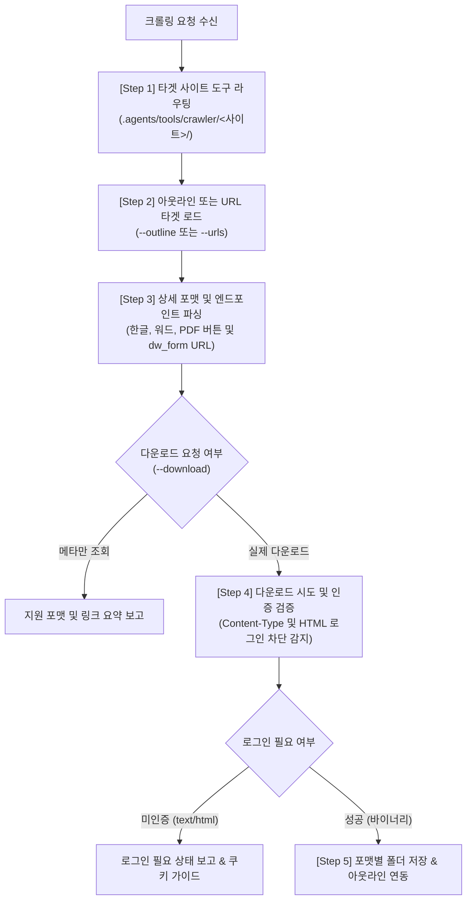

# 🕷️ External PM Multi-Source Form Crawler (외부 서식 수집 크롤러 스킬)

본 스킬은 외부 볼트(`What-s-in-my-head`)의 문서 서식 수집 파이프라인(`📑 문서_서식_수집_파이프라인`)에 정의된 다양한 수급처 허브로부터 **무료 서식 메타데이터 수집, 포맷별(PDF, HWP, DOC, XLS) 다운로드 링크 추출, 실물 파일 로컬 다운로드**를 수행하는 **사이트 확장형 크롤링 표준 스킬**입니다.

새로운 수급처(예: 비즈폼, 미리캔버스, 알바몬 등)가 추가될 때마다 `.agents/tools/crawler/<사이트명>/` 하위에 모듈을 지속 확장하는 아키텍처를 채택합니다.

---

## 🎯 1. 발동 시점 (Triggers)

1. "예스폼에서 회의록 서식 크롤링해줘", "서식 다운받아줘"
2. "아웃라인에 등록된 서식 링크 1~N번 파일(PDF/한글 등) 내려받아줘"
3. 특정 수급처 허브의 전체 무료 서식 목록을 CSV나 아웃라인으로 덤프해야 할 때
4. 수급처에서 제공하는 파일 포맷(한글, 워드, PDF, 구글시트 등) 가용성을 전수 검증할 때

---

## 🛠️ 2. 보유 도구 자산 (`.agents/tools/crawler/`)

모든 크롤러는 사이트별 하위 디렉터리에 격리되며, 일관된 CLI 인터페이스를 제공합니다:

| 수급처 | 도구 경로 | 주요 기능 | 특이사항 |
| :--- | :--- | :--- | :--- |
| **예스폼** | `.agents/tools/crawler/yesform/yesform_crawler.py` | 목록 검색, 무료 판별, 포맷 파싱, 파일 다운로드 | 검색어 EUC-KR, 무료 서식 다운로드 시에도 회원 로그인 세션 쿠키 필수 |
| *(확장 예정)* | `.agents/tools/crawler/<사이트명>/<사이트명>_crawler.py` | 동일한 표준 CLI 인터페이스 구현 | 사이트별 파싱 규칙 및 인증 방식 독립 격리 |

### 표준 CLI 옵션 규격
모든 사이트 크롤러는 아래의 공통 옵션을 준수합니다:
- `--search <검색어>` : 사이트 검색어 기반 수집
- `--pages <N>` : 수집할 검색 목록 페이지 수 (기본 1)
- `--urls <URL...>` : 직접 지정한 상세 페이지 URL 처리
- `--outline <경로>` : `.outline` 파일에서 마크다운 링크 파싱 후 타겟팅
- `--limit <N>` : 처리할 최대 서식 건수
- `--format <pdf|hwp|word|xls>` : 타겟 다운로드 포맷 (기본 `pdf`)
- `--download` : 실제 파일 다운로드 플래그 (미지정 시 메타데이터만 조회)
- `--cookie "<문자열>"` : 회원 로그인 세션 쿠키 (다운로드 시 필요)
- `--output-dir <경로>` : 파일 저장 경로 (기본 `./yesform_downloads`)

---

## 📋 3. 5단계 크롤링 프로토콜 (The 5-Tier Protocol)



### [Step 1] 타겟 도구 및 대상 확인
- 사용자가 지정한 아웃라인(`.outline`) 경로 또는 상세 URL을 확인합니다.
- 사이트에 맞는 크롤러 실행 스크립트를 선택합니다.

### [Step 2] 메타데이터 및 포맷 선행 점검 (드라이 런)
```bash
# 파일 다운로드 없이 지원 포맷 및 다운로드 링크만 먼저 확인
python .agents/tools/crawler/yesform/yesform_crawler.py \
  --outline "<아웃라인파일경로>" \
  --limit 5 \
  --format pdf
```

### [Step 3] 인증 세션 확인 및 다운로드 실행
```bash
# 실제 파일 다운로드 실행
python .agents/tools/crawler/yesform/yesform_crawler.py \
  --outline "<아웃라인파일경로>" \
  --limit 5 \
  --format pdf \
  --download \
  --cookie "PHPSESSID=...; login_cookie=..." \
  --output-dir "./downloads"
```

### [Step 4] 응답 타입 판별 및 인증 가드레일 대응
- **정상 다운로드**: `Content-Type`이 `application/pdf`, `application/octet-stream` 등 바이너리로 수신되며 지정된 폴더에 저장됩니다.
- **로그인 차단 감지**: 무료 서식이라도 `text/html`로 `alert("로그인 하신 회원만 이용 가능 합니다.")`가 오는 경우, 즉시 `need_login`으로 분류하고 사용자에게 브라우저 세션 쿠키 입력을 요청합니다.

### [Step 5] 아웃라인 및 작업 결과 매듭
- 성공한 파일의 로컬 경로를 집계합니다.
- 필요 시 아웃라인 트리 자식 노드에 다운로드 완료 상태 또는 로컬 상대 경로를 업데이트합니다.

---

## 🧠 4. 크롤러 가드레일 (Guardrails)

1. **서버 부하 방지 (Politeness Delay)**:
   - 요청 간격 최소 1.0초 이상의 딜레이(`--delay 1.0`)를 강제합니다. 무분별한 동시 병렬 요청은 금지합니다.
2. **헤드리스 브라우저 남발 금지**:
   - 브라우저를 직접 띄우지 않고, 경량 HTTP 클라이언트(`requests`/`Session`)를 우선 사용하여 토큰과 리소스를 절약합니다.
3. **인증 강제 사이트의 정직한 보고**:
   - 사이트가 로그인을 요구하여 HTML 에러 페이지를 반환할 때, 임의로 빈 파일이나 위조 파일을 만들지 않습니다. 반드시 `need_login`으로 실패 원인을 명확히 보고합니다.
4. **인코딩 무결성 준수**:
   - 국내 레거시 서식 사이트(예스폼 등)는 EUC-KR 및 UTF-8이 혼용됩니다. 파일명 추출 시 `latin-1 -> euc-kr` 복원 로직을 반드시 거쳐 한글 파일명 깨짐을 방어합니다.
5. **도메인 정체성 준수**:
   - 본 프로젝트는 **범용 문서 빌더/스캐폴딩 엔진, 리치 텍스트·캔버스 시각화, 도메인 중립 Agent 런타임 시스템**입니다. 소설, 웹소설 등 창작 용어나 비유는 일체 사용하지 않습니다.
